# Hello Cloud Run — Containerized Node.js Deployment on Google Cloud

Lab walkthrough and reference implementation for building a stateless Express.js application, containerizing it with Docker and Cloud Build, storing the image in Artifact Registry, and deploying it to **Google Cloud Run**.

## Lab Summary

| Item | Value |
| :--- | :--- |
| **Platform** | Google Cloud Run & Artifact Registry |
| **Runtime** | Node.js (`node:22-slim`) + Express `^4.17.1` |
| **Region** | `us-east4` |
| **Project ID (Lab)** | `qwiklabs-gcp-04-9e6cbfbd84b3` |
| **Artifact Registry Repo** | `my-repository` |
| **Deployed Service URL** | `https://helloworld-239027691572.us-east4.run.app` |

## Objectives

1. Enable the Cloud Run and Artifact Registry APIs.
2. Create a stateless Node.js HTTP service using Express.
3. Create a Docker repository in Artifact Registry and configure Docker auth.
4. Containerize the app with a `Dockerfile` and build/push it with Cloud Build.
5. Verify the container locally via Cloud Shell Web Preview and deploy to Cloud Run.
6. Clean up container images and Cloud Run services after verification.

## Repository Structure

```text
.
├── Dockerfile
├── index.js
├── package.json
├── .gitignore
├── README.md
└── screenshots/
    ├── 01-cloud-shell-auth-project.png
    ├── 02-task1-enable-apis-and-region.png
    ├── 03-task2-create-helloworld-dir.png
    ├── 04-task2-package-json.png
    ├── 05-task2-index-js.png
    ├── 06-task3-create-artifact-repo.png
    ├── 07-task3-configure-docker-auth.png
    ├── 08-task4-cloud-build-start.png
    ├── 09-task4-cloud-build-push-done.png
    ├── 10-task4-cloud-build-success.png
    ├── 11-task4-docker-run-web-preview.png
    ├── 12-task4-local-preview-hello-world.png
    ├── 13-task5-cloud-run-deploy.png
    ├── 14-task5-live-service-hello-world.png
    ├── 15-task5-cloud-run-console-service.png
    ├── 16-task6-delete-container-image.png
    ├── 17-task6-delete-cloud-run-service.png
    └── 18-task6-cloud-run-cleanup-verified.png
```

---

## Setup: Verify Cloud Shell Authentication & Project

Confirm the active account and target Google Cloud project inside Cloud Shell:

```bash
gcloud auth list
gcloud config list project
```

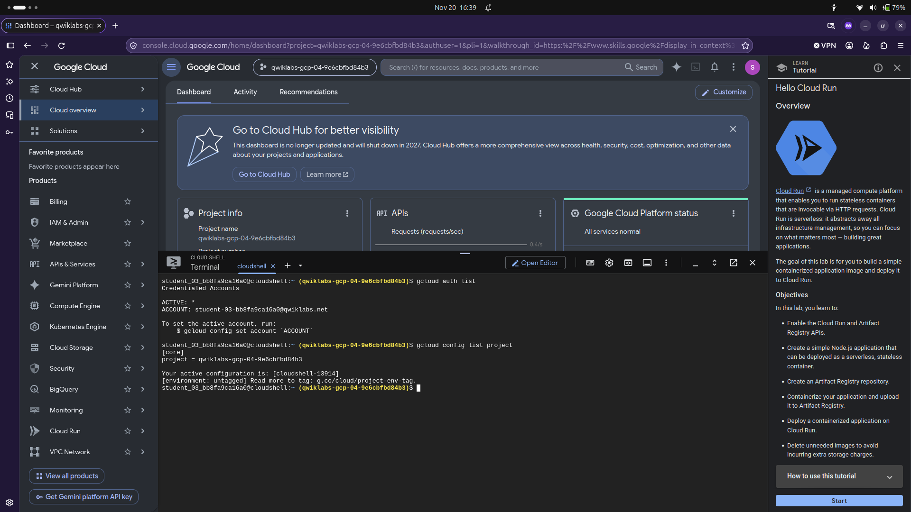
*Verify active Qwiklabs account and project configuration (qwiklabs-gcp-04-9e6cbfbd84b3).*

---

## Task 1: Enable APIs & Configure Region

Enable the Cloud Run and Artifact Registry APIs and set the compute region:

```bash
gcloud services enable run.googleapis.com artifactregistry.googleapis.com
gcloud config set compute/region "us-east4"
LOCATION="us-east4"
```

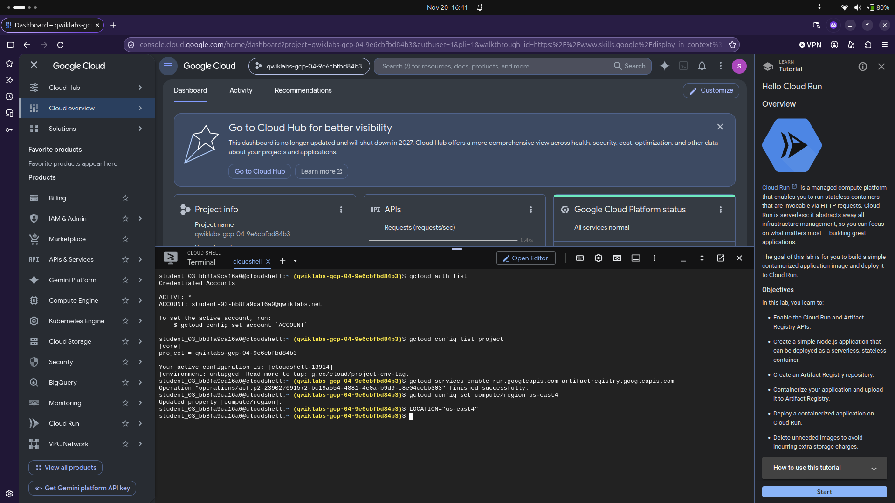
*Enable run.googleapis.com and artifactregistry.googleapis.com and configure region us-east4.*

---

## Task 2: Write the Sample Node.js Application

Create the `helloworld` directory along with `package.json` and `index.js`:

```bash
mkdir helloworld && cd helloworld
```

```json
{
  "name": "helloworld",
  "description": "Simple hello world sample in Node",
  "version": "1.0.0",
  "main": "index.js",
  "scripts": {
    "start": "node index.js"
  },
  "author": "Google LLC",
  "license": "Apache-2.0",
  "dependencies": {
    "express": "^4.17.1"
  }
}
```

```javascript
const express = require('express');
const app = express();
const port = process.env.PORT || 8080;

app.get('/', (req, res) => {
  const name = process.env.NAME || 'World';
  res.send(`Hello ${name}!`);
});

app.listen(port, () => {
  console.log(`helloworld: listening on port ${port}`);
});
```

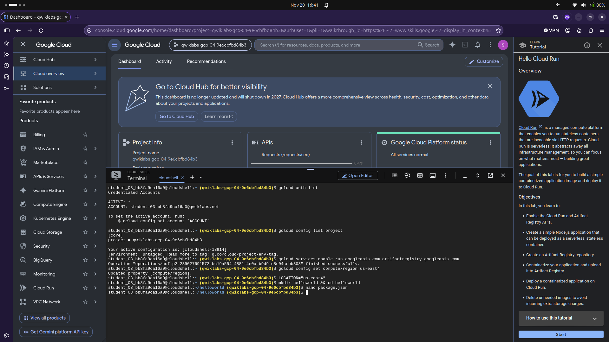
*Create and navigate into the helloworld directory before writing package.json.*

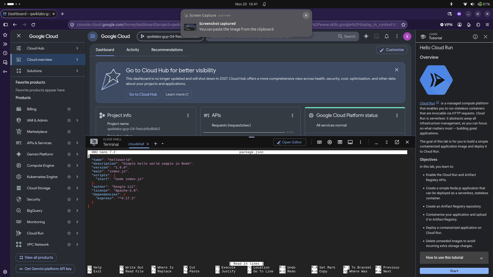
*Define Node.js start script and Express dependency (^4.17.1) in package.json.*

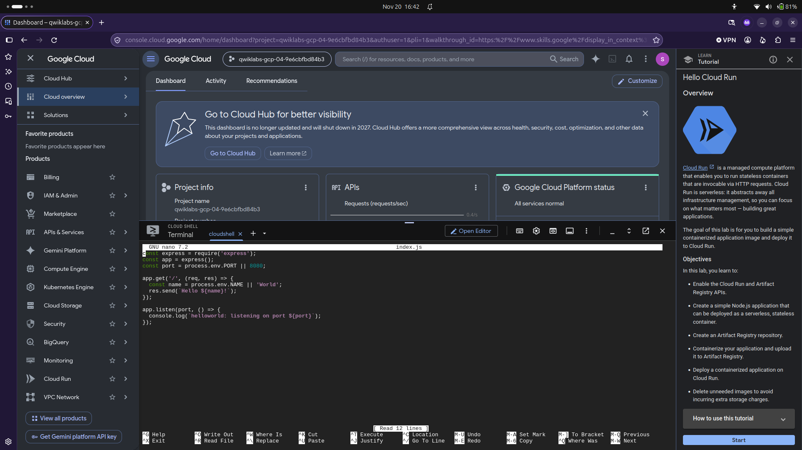
*Create the HTTP server listening on process.env.PORT || 8080 and responding with Hello World!*

---

## Task 3: Create an Artifact Registry Repository

Create the Docker repository `my-repository` in `$LOCATION` and configure Docker authentication:

```bash
gcloud artifacts repositories create my-repository \
  --repository-format=docker \
  --location=$LOCATION \
  --description="Docker repository"

gcloud auth configure-docker $LOCATION-docker.pkg.dev
```

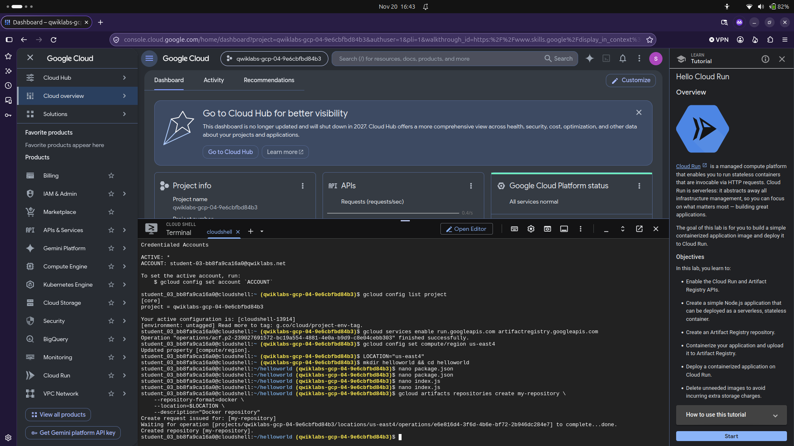
*Create the my-repository Docker repository in us-east4 via gcloud artifacts repositories create.*

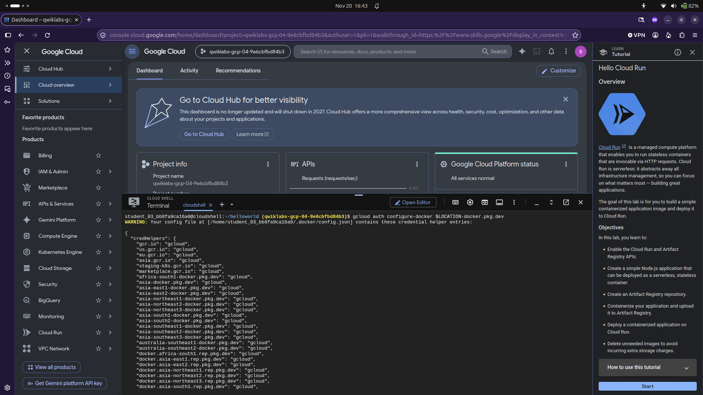
*Configure Docker credential helpers for us-east4-docker.pkg.dev.*

---

## Task 4: Containerize the App & Build with Cloud Build

Create the `Dockerfile` using `node:22-slim`:

```dockerfile
FROM node:22-slim
WORKDIR /usr/src/app
COPY package*.json ./
RUN npm install --only=production
COPY . ./
CMD [ "npm", "start" ]
```

Build and push the image to Artifact Registry, then verify locally on port `8080`:

```bash
gcloud builds submit --tag $LOCATION-docker.pkg.dev/$GOOGLE_CLOUD_PROJECT/my-repository/helloworld

docker run -d -p 8080:8080 $LOCATION-docker.pkg.dev/$GOOGLE_CLOUD_PROJECT/my-repository/helloworld
```

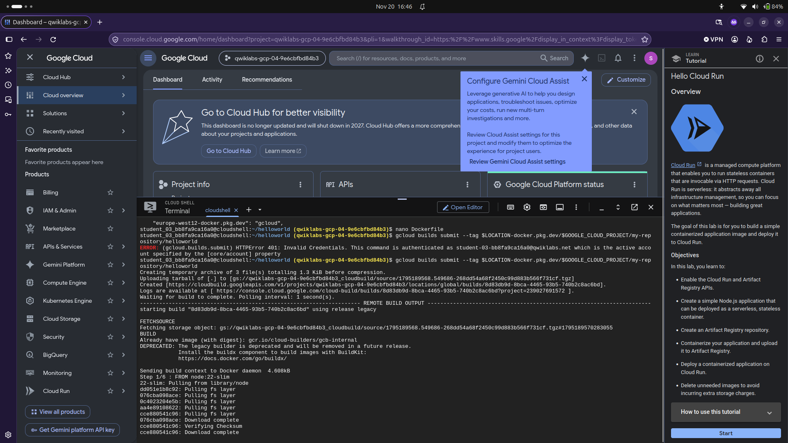
*After refreshing credentials, gcloud builds submit uploads source and starts Step 1/6 (FROM node:22-slim).*

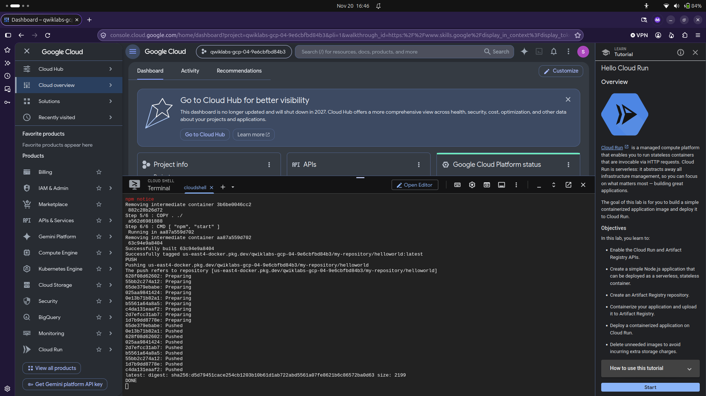
*Cloud Build completes steps 5/6 and 6/6 and pushes all layers to Artifact Registry.*

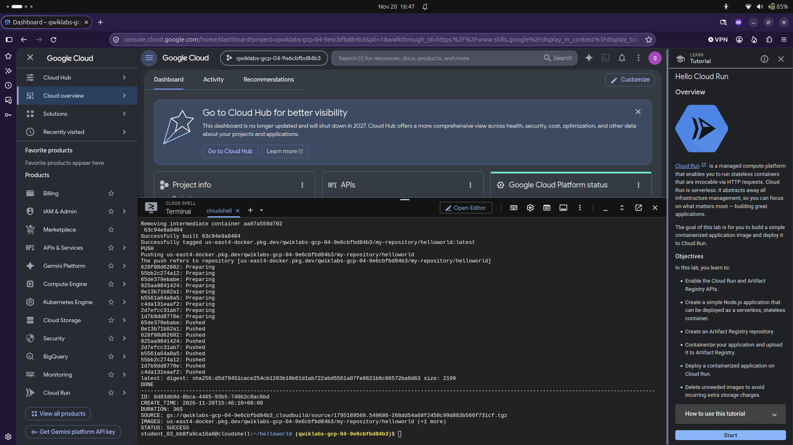
*Build ID 8d83db9d-8bca-4465-93b5-740b2c8ac6bd completes in 36s with STATUS: SUCCESS.*

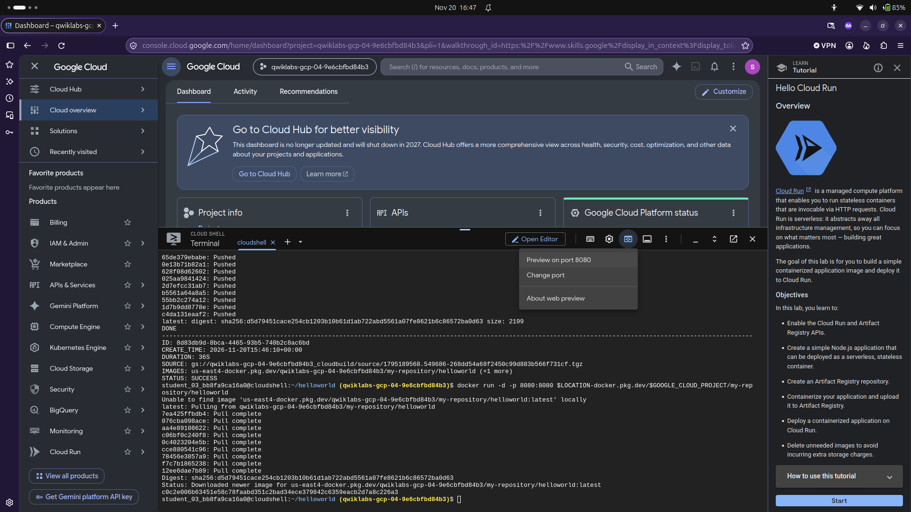
*Start the built image locally on port 8080 via docker run and select Preview on port 8080.*

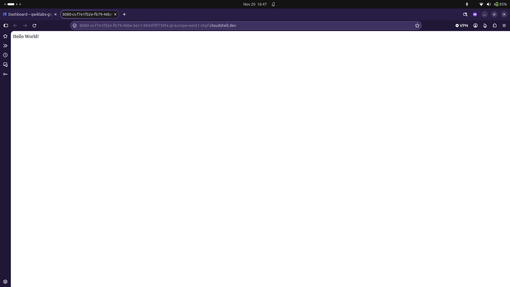
*Cloud Shell Web Preview on port 8080 renders "Hello World!".*

---

## Task 5: Deploy to Cloud Run

Deploy the container image from Artifact Registry as a publicly accessible Cloud Run service:

```bash
gcloud run deploy helloworld \
  --image $LOCATION-docker.pkg.dev/$GOOGLE_CLOUD_PROJECT/my-repository/helloworld \
  --allow-unauthenticated \
  --region=$LOCATION
```

Verified live endpoint: `https://helloworld-239027691572.us-east4.run.app` returning `Hello World!`.

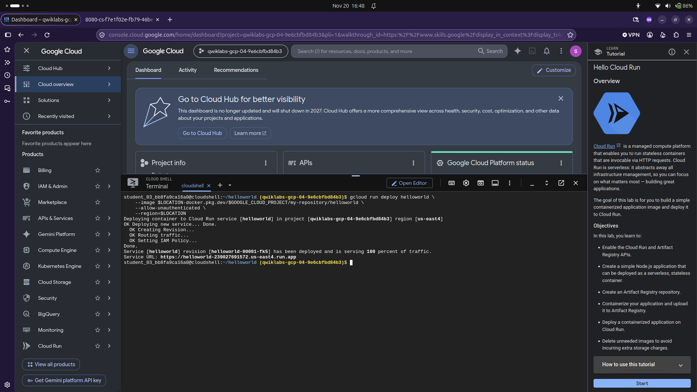
*Deploy helloworld revision helloworld-00001-fk5 serving 100% traffic in us-east4.*

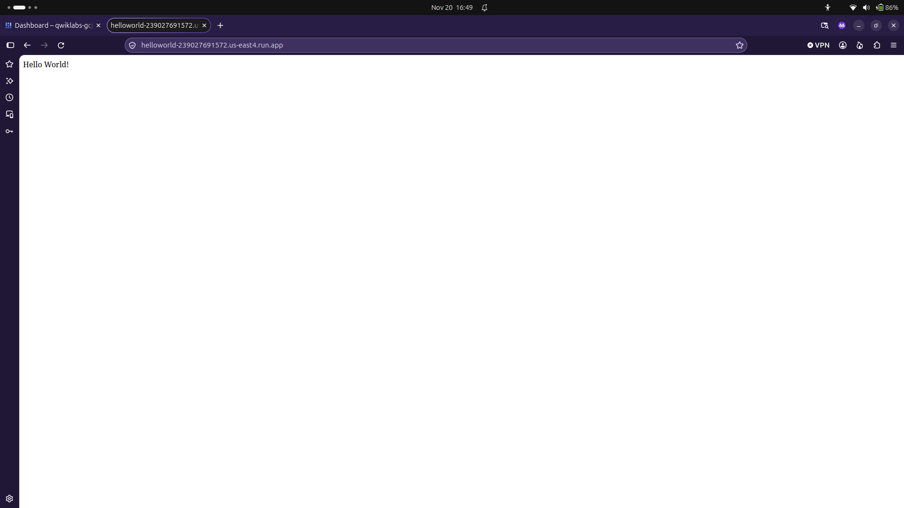
*Public Cloud Run URL (helloworld-239027691572.us-east4.run.app) serves "Hello World!".*

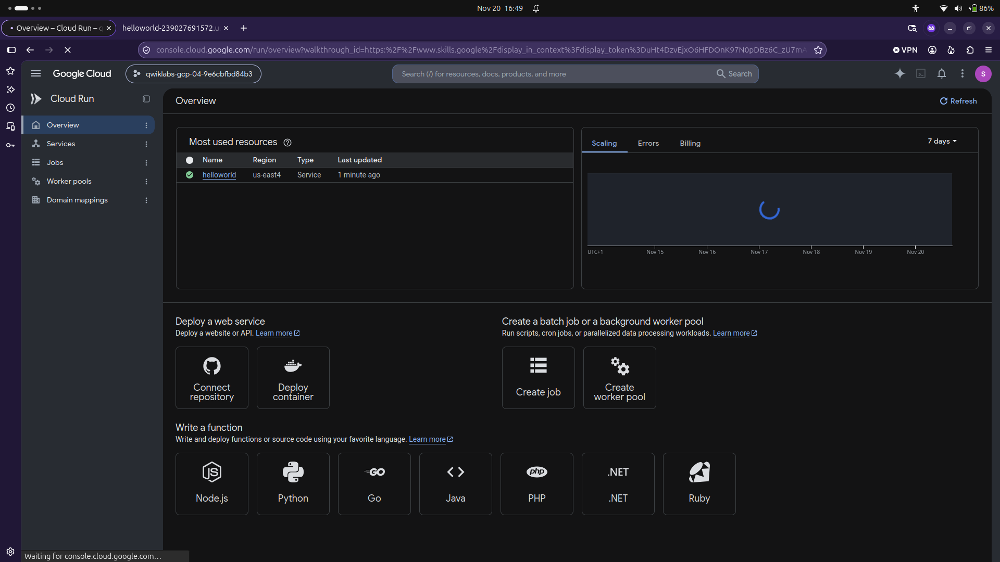
*Google Cloud Console shows the active helloworld service deployed in us-east4.*

---

## Task 6: Clean Up Resources

To avoid incurring ongoing Artifact Registry storage charges after finishing the lab, remove the container image and Cloud Run service:

```bash
# Delete the container image from Artifact Registry
gcloud artifacts docker images delete $LOCATION-docker.pkg.dev/$GOOGLE_CLOUD_PROJECT/my-repository/helloworld

# Delete the Cloud Run service
gcloud run services delete helloworld --region=$LOCATION
```

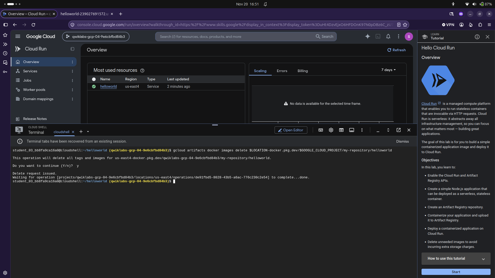
*Delete the helloworld image tags from Artifact Registry to avoid storage charges.*

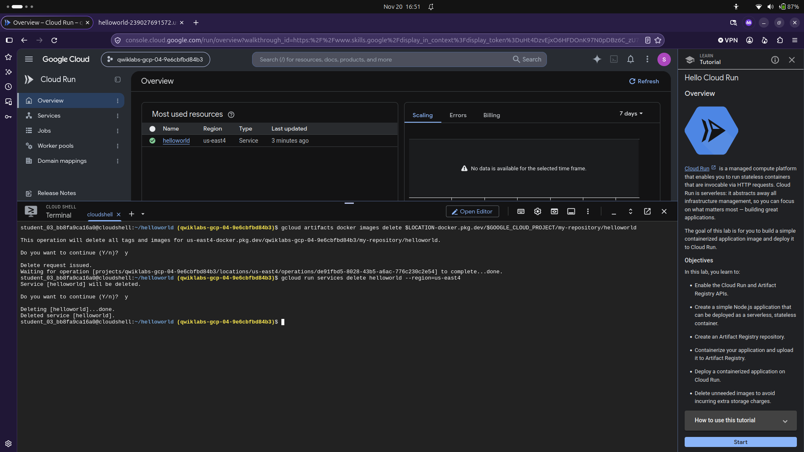
*Delete the helloworld Cloud Run service from us-east4.*

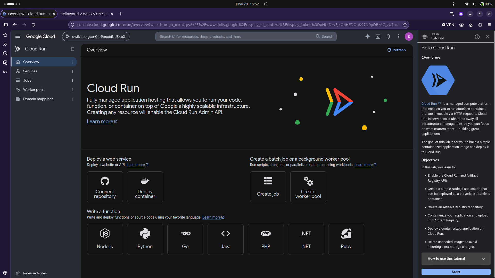
*Confirm in the Cloud Run Overview console that no active services remain.*

---

## Troubleshooting Notes

- **401 Invalid Credentials during `gcloud builds submit`**: If Cloud Shell loses connection or temporary lab credentials expire mid-session, refresh the browser or re-run `gcloud auth list` / reconnect Cloud Shell before retrying `gcloud builds submit`.
- **Docker Base Image**: `node:22-slim` was used in the `Dockerfile` for a compact Node.js production image.
